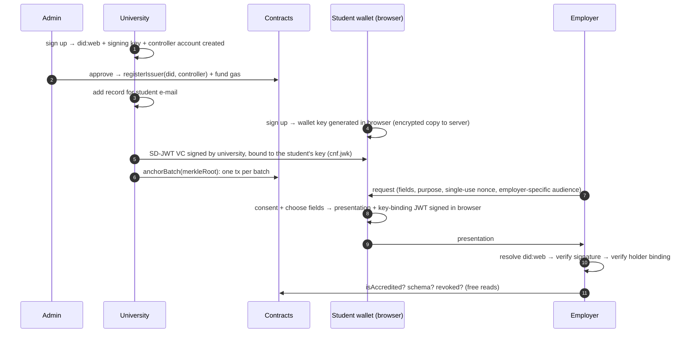

# BlockCred

**Tamper-proof academic credentials that students own and employers can verify in seconds.**

BlockCred is a multi-user platform with four kinds of accounts that interact with each other:

| Account | What it does |
|---|---|
| 🏛️ **Accreditation admin** | Approves universities. Approval registers the university's DID on-chain in the `IssuerRegistry`. It can also suspend or reinstate them |
| 🎓 **University** | Gets its own `did:web` identity and signing keys. Issues degrees to students' e-mail addresses (form, CSV or mocked DigiLocker), revokes them on-chain and anchors batches |
| 👩‍🎓 **Student** | Wallet key is created in the browser. Degrees arrive automatically. Answers employers' requests by choosing exactly which fields to share |
| 🏢 **Employer** | Sends verification requests to a candidate's e-mail (or as a code/QR) and gets a cryptographically verified result |

Everything is free and open-source: a local Hardhat chain (or the Polygon Amoy / Sepolia testnets), PostgreSQL, Node.js and React.

| Layer | Technology |
|---|---|
| Identity | **did:web** per university (`did:web:<host>:issuers:<slug>`), P-256 keys |
| Credentials | **SD-JWT VC** with selective disclosure and holder key binding |
| Trust, revocation, anchoring | Solidity on any EVM chain, OpenZeppelin 5 (`AccessControl`, `Pausable`, `MerkleProof`) |
| Backend | Node.js 22, Express 5, PostgreSQL 16, ethers v6 |
| Frontend | React 18 + Vite (responsive, works on phones) |
| Crypto | WebCrypto ES256, PBKDF2 + AES-GCM key wrapping, scrypt, OpenZeppelin `StandardMerkleTree` |

---

## Quick start (Docker)

**Prerequisites:** Docker Desktop (or Docker Engine + Compose v2) and Node.js ≥ 20.10.

```bash
npm run setup               # creates .env and prints the admin login
docker compose up --build   # postgres, chain, contract deployment, API, web app
```

Open **http://localhost:5173** when you see `BlockCred API listening`.

> **Upgrading from v1?** Run these instead:
> ```bash
> docker compose down -v --remove-orphans
> npm run setup -- --force
> docker compose up --build
> ```

To see the admin login again later: `npm run setup` (it prints the existing one), or check `ADMIN_EMAIL` / `ADMIN_PASSWORD` in `.env`.

**Tip:** run `docker compose up -d --build`, then `docker compose logs -f api`, to see only the useful logs.

---

## Walkthrough: four accounts interacting

Use a **normal window + a private/incognito window** (or two browsers), because each browser holds one login at a time. Log out and in to switch roles.

1. **Create a university.** Click *Create account → University*, enter e.g. "IIT Demo", `registrar@iitdemo.edu` and a password.
   - The dashboard shows *waiting for approval*. Your institution already has a DID; click it to see its DID document.
2. **Approve it as the admin.** In the other window, log in with the admin e-mail and password from `.env`.
   - Under *Institutions*, click **Approve**.
   - This writes the university's DID and controller account into the `IssuerRegistry` contract, and funds the controller with test ETH for gas.
3. **Issue a degree.** Back in the university window (it refreshes on its own), fill in *Issue a degree* with a student e-mail, e.g. `asha@example.com`.
   - The record shows **Awaiting student sign-up**, because Asha has no account yet.
   - You can also upload a CSV (`samples/students.csv`) or click *Import from DigiLocker (mock)*.
4. **Student signs up.** Log out of the admin window and choose *Create account → Student* with **the same e-mail** (`asha@example.com`).
   - The browser generates Asha's wallet key, and the degree appears under **My credentials** immediately.
   - The university's record switches to **issued**.
5. **Create an employer.** In another window, choose *Create account → Employer* (e.g. "Acme Corp").
   - Under *Request a verification*, enter `asha@example.com`, keep *Degree* and *Graduation date* ticked, and click **Send request**.
6. **Student responds.** In Asha's wallet the request appears under *Verification requests* within a few seconds.
   - Click **Review**. Untick or tick fields (try hiding CGPA), then click **I consent**.
7. **Employer sees the result.** The employer's request turns **Valid credential**. Click it to see only the shared fields, plus every check:
   - DID resolved, signature, holder binding;
   - accredited on-chain, schema registered, not revoked, anchored.
8. **Revoke.** In the university dashboard click **Revoke** on Asha's record (an on-chain transaction).
   - The employer sends a new request and Asha answers. The result is now **Revoked by issuer**.
9. **More to try:**
   - **Suspend the university** as the admin, then verify again: *Untrusted issuer*. Reinstate it.
   - **Rotate signing key**: old degrees still verify. **Report key compromised**: degrees signed by the old key stop verifying.
   - **Open request:** leave the candidate e-mail empty to get a code/QR. The student uses *Have a request code?*.
   - **Log in as the student from another browser.** The wallet key is unlocked with the password.
   - Student **Sharing history** (DPDP consent log) and **Delete my account**.

Run the whole scenario automatically: `npm install && npm run e2e`.

---

## Run without Docker

**Prerequisites:** Node.js ≥ 20.10, plus PostgreSQL 14+ (or just `docker compose up -d postgres`).

```bash
npm install
npm run setup
npm run chain          # terminal 1: local blockchain
npm run deploy:local   # terminal 2: deploy contracts (writes contracts/deployments/localhost.json)
npm run db:up          #             postgres in docker (skip if you run your own)
npm run dev:api        # terminal 3: http://localhost:4000
npm run dev:web        # terminal 4: http://localhost:5173
```

If you restart `npm run chain`, re-run `npm run deploy:local` and reset the database (`docker compose down -v`). The chain starts empty again.

---

## How it works



| Data | Where | Why |
|---|---|---|
| University DID, controller, status | `IssuerRegistry` (on-chain) | Public trust anchor, governed by the admin |
| Revocation bit, batch Merkle roots | `RevocationRegistry`, `MerkleAnchor` | Tamper-evident, no personal data |
| University public keys | did:web document served at `/issuers/<slug>/did.json` | Standard DID resolution, key rotation |
| University private keys | Postgres, AES-256-GCM encrypted (`MASTER_ENCRYPTION_KEY`) | Replace with KMS/HSM in production |
| Student wallet private key | Browser (non-extractable). The server holds only a copy **encrypted with the student's password**, which it never sees | Multi-device login without the platform being able to use it |
| Signed credentials | Student's cloud wallet (DB) | Delivered between accounts |
| Shared values at verification | Employer result, purged after `RESULT_RETENTION_HOURS` | DPDP purpose limitation |
| Passwords | Never sent. The client sends a PBKDF2-derived secret, which the server hashes again with scrypt | — |

Further reading: [docs/ARCHITECTURE.md](docs/ARCHITECTURE.md), [docs/THREAT_MODEL.md](docs/THREAT_MODEL.md), [docs/DPDP_COMPLIANCE.md](docs/DPDP_COMPLIANCE.md).

---

## Project structure

```
blockcred/
├── contracts/            Solidity contracts, Hardhat tests, deploy/governance scripts
├── packages/sdk/         @blockcred/sdk: SD-JWT, did:web, chain reads, verification, key wrapping
├── services/api/         Platform API (accounts, roles, issuance, verification, anchoring)
│   ├── src/routes/       auth · admin · university · student · employer
│   └── migrations/       PostgreSQL schema
├── apps/web/             React app: login/sign-up + one dashboard per role
├── scripts/              setup-env, e2e scenario
├── samples/              students.csv, digilocker-mock.json
├── docs/                 architecture, threat model, DPDP compliance
├── docker-compose.yml    full local stack
└── Dockerfile            multi-target (dev / service / web)
```

---

## Testing

```bash
npm test                # contracts + SDK + API unit tests
npm run test:contracts  # Hardhat: access control, bit packing, Merkle inclusion, pause, …
npm run test:sdk        # SD-JWT tampering/replay/audience/expiry, did:web, verifier verdicts, key wrapping
npm run test:api        # CSV parsing, secret box, password hashing
npm run e2e             # four accounts end-to-end against a running stack
```

GitHub Actions (`.github/workflows/ci.yml`) runs the unit tests, builds the web app, boots the Docker stack and runs the e2e scenario on every push.

---

## API overview

All routes are under `/api` and use an HttpOnly, SameSite=Strict session cookie.

| Role | Endpoints |
|---|---|
| Public | `POST /auth/signup`, `POST /auth/login`, `POST /auth/logout`, `GET /auth/me`, `GET /issuers` (accredited directory), `GET /issuers/:slug/did.json` (did:web, no `/api` prefix) |
| Admin | `GET /admin/overview`, `POST /admin/issuers/:id/{approve,reject,suspend,reinstate}` |
| University | `GET /university/overview`, `POST /university/credentials` (JSON or `text/csv`), `GET /university/credentials`, `POST /university/credentials/:id/revoke`, `POST /university/anchor`, `POST /university/rotate-key`, `POST /university/import/digilocker` |
| Student | `GET /student/credentials`, `DELETE /student/credentials/:id`, `GET /student/requests`, `GET /student/requests/:id`, `POST /student/requests/:id/respond`, `POST /student/requests/:id/decline`, `GET /student/consents`, `DELETE /student/account` |
| Employer | `POST /employer/requests`, `GET /employer/requests` |

---

## Deploy on a free public testnet (Polygon Amoy / Sepolia)

1. Create a deployer account (MetaMask) and fund it from a faucet: Polygon Amoy faucet (faucet.polygon.technology) or a Sepolia faucet (Google Cloud Web3, Alchemy).
2. In `.env`, set:
   ```bash
   DEPLOYER_PRIVATE_KEY=0x...
   PLATFORM_GOVERNOR_PRIVATE_KEY=0x...   # same key (the deployer is the first governor)
   ISSUER_FUNDING_ETH=0.05               # gas money per approved university
   RPC_URL=https://rpc-amoy.polygon.technology
   CHAIN_ID=80002
   DEPLOYMENTS_FILE=contracts/deployments/amoy.json
   VITE_EXPLORER_TX_URL=https://amoy.polygonscan.com/tx/
   ```
3. Run `npm run deploy:amoy` (or `deploy:sepolia` with `CHAIN_ID=11155111`).
4. Start the API and web app (`npm run dev:api`, `npm run dev:web`). Every approval, revocation and anchor is now a real public transaction you can open on the block explorer.

For other verifiers on the internet to resolve university DIDs, the API must be reachable over HTTPS with `PUBLIC_URL` set to that address. For example, deploy it on a free tier (Render / Railway / Fly.io) or expose it with a free Cloudflare Tunnel. Then clear `DID_WEB_ALLOW_HTTP_HOSTS`.

---

## Production checklist

- **Already in place:**
  - Stateless API, so you can run many replicas.
  - Postgres advisory locks serialise on-chain writes per account and make anchoring single-leader.
  - Lock-protected migrations; rate limits; zod validation everywhere; helmet; structured logs; health and readiness probes.
- **Governance:** hold `DEFAULT_ADMIN_ROLE` / `GOVERNOR_ROLE` in a Safe multi-sig. The platform governor key should only be a limited operator.
- **Secrets:** move university signing keys and controller keys from the encrypted DB to a KMS/HSM. The SDK signer interface is pluggable.
- **E-mail verification:** add it (for example with a free SMTP tier or self-hosted Mailpit). Today, whoever registers an e-mail first receives credentials issued to it.
- **Deployment:** set `NODE_ENV=production`, `COOKIE_SECURE=true` and put TLS in front. Use managed Postgres with backups. Build with `docker build --target service` and `docker build --target web`.
- **Audit:** get an independent smart-contract audit before any mainnet use.

## Limitations and future work

- **Predicate proofs** ("CGPA > 8" without revealing it) need BBS+ or ZK range proofs.
- **Protocols:** issuance and presentation are OpenID4VCI/VP-*inspired*, not spec-complete.
- **Wallet:** credentials are stored in a platform-hosted wallet. A native wallet with hardware-bound keys would make the student fully independent of the platform.
- **Password recovery:** a forgotten student password means losing the wallet key. The university can re-issue the degree to a new account.
- **DigiLocker:** mocked.

## Push to GitHub

```bash
git init && git add . && git commit -m "BlockCred v2: multi-account credential platform"
git branch -M main
git remote add origin https://github.com/<you>/blockcred.git
git push -u origin main
```

`.env` is git-ignored. Never commit it: it holds your encryption key and admin password.

## License

MIT
