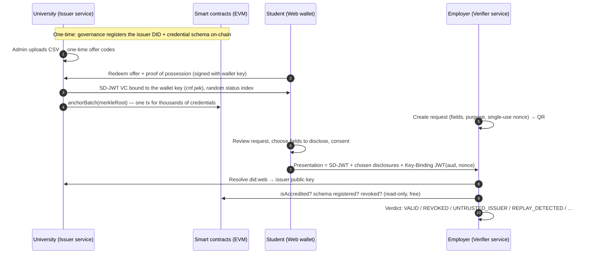

# BlockCred

**Tamper-proof academic credentials that students own and employers can verify in seconds, without calling the university.**

BlockCred is a full-stack verifiable credential system built on open standards and free tooling:

| Layer | Technology |
|---|---|
| Issuer identity | **did:web** (W3C DID), P-256 keys, published at `/.well-known/did.json` |
| Credential format | **SD-JWT VC** (IETF Selective Disclosure JWT) with holder key binding |
| Trust registry, revocation, anchoring | **Solidity** smart contracts on any EVM chain: local Hardhat, **Polygon Amoy** or **Ethereum Sepolia** testnets (free) |
| Contract tooling | Hardhat + OpenZeppelin Contracts 5 (`AccessControl`, `Pausable`, `MerkleProof`) |
| Services | Node.js 22, Express 5, PostgreSQL 16, ethers v6 |
| Wallet / portals | React 18 + Vite (responsive web wallet that works on phones) |
| Crypto | WebCrypto (ES256): no hand-rolled primitives. Batches use OpenZeppelin `StandardMerkleTree` |

All of it is open-source and free to run. You pay nothing on a local chain or a testnet.

---

## Table of contents

1. [How it works](#how-it-works)
2. [Project structure](#project-structure)
3. [Quick start (Docker, 5 minutes)](#quick-start-docker)
4. [Run locally without Docker](#run-locally-without-docker)
5. [Demo walkthrough](#demo-walkthrough)
6. [Testing](#testing)
7. [Deploy to a public testnet (Polygon Amoy / Sepolia)](#deploy-to-a-public-testnet)
8. [Host the issuer DID on GitHub Pages](#host-the-issuer-did-on-github-pages)
9. [API reference](#api-reference)
10. [Configuration reference](#configuration-reference)
11. [Production hardening and scaling](#production-hardening-and-scaling)
12. [How this maps to the implementation guide](#how-this-maps-to-the-implementation-guide)
13. [Limitations and future work](#limitations-and-future-work)
14. [Pushing to GitHub](#pushing-to-github)

---

## How it works



**What lives where:**

| Data | Location | Why |
|---|---|---|
| Issuer DID ↔ controller account, accreditation status | `IssuerRegistry` (on-chain) | Tamper-evident trust anchor, governed by multi-sig in production |
| Credential schema hash (`vct`) | `IssuerRegistry` (on-chain) | Verifiers only accept recognised credential types |
| Revocation bit | `RevocationRegistry` bitstring (on-chain) | O(1) check, no PII; index is random so it reveals nothing |
| Batch Merkle root | `MerkleAnchor` (on-chain) | Tamper-evidence + trusted issuance time without per-credential gas |
| Issuer public keys | did:web document (HTTPS) | Standard DID resolution and simple key rotation |
| Full credential (name, CGPA, …) | **Student's wallet only** | Never on-chain. The issuer DB stores only a hash |
| Disclosed values at verifier | Verifier DB, auto-purged after `RESULT_RETENTION_SEC` | DPDP purpose limitation |

Read more in [docs/ARCHITECTURE.md](docs/ARCHITECTURE.md), [docs/THREAT_MODEL.md](docs/THREAT_MODEL.md) and [docs/DPDP_COMPLIANCE.md](docs/DPDP_COMPLIANCE.md).

---

## Project structure

```
blockcred/
├── contracts/                 Hardhat project
│   ├── contracts/             IssuerRegistry.sol, RevocationRegistry.sol, MerkleAnchor.sol
│   ├── scripts/               deploy.js, register-issuer.js, issuer-admin.js
│   └── test/                  Chai/Mocha tests (roles, bit packing, Merkle proofs, pause, …)
├── packages/sdk/              @blockcred/sdk: isomorphic (Node + browser) verifier SDK
│   ├── src/jws.js             strict ES256 JWS on WebCrypto
│   ├── src/sdjwt.js           SD-JWT issue / present / verify (+ key binding, decoys)
│   ├── src/did.js             did:web resolution with cache + DID document builder
│   ├── src/chain.js           contract reads (herd-private revocation lookups)
│   ├── src/merkle.js          OpenZeppelin-compatible Merkle proofs
│   └── src/verify.js          full verification pipeline → verdicts
├── services/issuer/           Issuer API: did:web, offers, issuance, anchoring worker, revocation
├── services/verifier/         Verifier API: nonce-bound requests, verification, consent log
├── apps/web/                  React app: Wallet (student), Issuer portal, Verifier portal
├── scripts/                   setup-env, rotate-issuer-key, e2e scenario
├── samples/                   students.csv, digilocker-mock.json
├── docs/                      architecture, threat model, DPDP compliance
├── docker-compose.yml         full local stack
└── Dockerfile                 multi-target (dev / service / web)
```

---

## Quick start (Docker)

**Prerequisites:** Docker Desktop (or Docker Engine + Compose v2) and Node.js ≥ 20.10 (only for `npm run setup`).

```bash
git clone https://github.com/<you>/blockcred.git
cd blockcred
npm run setup              # creates .env with a fresh issuer signing key + API keys (no install needed)
docker compose up --build  # postgres, hardhat chain, deploys contracts, issuer, verifier, web
```

When the logs show `issuer service listening` and `verifier service listening`, open:

| URL | What |
|---|---|
| http://localhost:5173 | Web app (Wallet / Issuer / Verifier tabs) |
| http://localhost:4000/.well-known/did.json | Issuer DID document |
| http://localhost:5000/health | Verifier health |

The admin API key for the Issuer tab is printed by `npm run setup` and stored as `ISSUER_ADMIN_API_KEY` in `.env`.

Run the automated end-to-end scenario against the running stack (it needs one `npm install` on the host first):

```bash
npm install
npm run e2e
```

> The Hardhat chain is in-memory. After stopping the stack, reset all state with `docker compose down -v` so the database and the chain stay consistent.

---

## Run locally without Docker

**Prerequisites:** Node.js ≥ 20.10, PostgreSQL 14+ (or `docker compose up -d postgres`).

```bash
npm install                 # installs all workspaces
npm run setup               # creates .env

# Terminal 1: local blockchain (chainId 31337, 20 pre-funded test accounts)
npm run chain

# Terminal 2: deploy contracts, register the demo issuer + degree schema
npm run deploy:local        # writes contracts/deployments/localhost.json
npm run db:up               # Postgres in Docker (skip if you have one; then set DATABASE_URL)

# Terminals 3, 4, 5
npm run dev:issuer          # http://localhost:4000
npm run dev:verifier        # http://localhost:5000
npm run dev:web             # http://localhost:5173
```

The services run their database migrations automatically on start-up.

If you restart `npm run chain`, run `npm run deploy:local` again. Hardhat reuses the same addresses on a fresh chain, but issuer registration and revocation state are lost.

---

## Demo walkthrough

1. **Issuer tab:** paste the admin API key. The status panel should show *Accredited*. Click **Create offers** (sample CSV preloaded). Each student gets a one-time code, a wallet link and a QR code.
2. Click **Open in wallet** for one student. The **Wallet tab** opens with the issuer URL and code pre-filled. Click **Accept credential**. The browser creates a non-extractable P-256 key, proves possession of it, and receives an SD-JWT VC bound to that key.
3. **Issuer tab:** click **Anchor pending batch**. The Merkle root of all new credentials is written on-chain in one transaction (this also runs automatically every `ANCHOR_INTERVAL_SEC`). In the wallet, open the credential and click **Fetch anchor proof**.
4. **Verifier tab** (try a second browser window): select *Degree* + *Graduation date*, then **Create request**. Copy the request JSON (or scan the QR with a phone running the wallet).
5. **Wallet tab:** paste the request into *Share with a verifier* and click **Review request**. You see who is asking, why, and which fields. Untick or tick fields and **consent**.
6. The **Verifier tab** updates to **Valid credential** and shows only the disclosed fields, plus every check: DID resolved, signature, holder binding, accreditation, schema, revocation and anchor.
7. **Revocation:** in the Issuer tab click **Revoke** on that credential (an on-chain transaction). Create a new request and present again. The verdict is **Revoked by issuer**, effective immediately.
8. **Replay:** a presentation can never be reused. Its nonce is consumed atomically and bound into the holder's signature (`npm run e2e` demonstrates this).
9. **Key rotation:** `npm run rotate-issuer-key`, then restart the issuer. Old credentials still verify (the old key is *retired* but still published) and new ones use `key-2`. With `-- --compromised`, the old key is removed and every credential it signed fails verification.

**Using a phone as the wallet:** browsers only allow WebCrypto and the camera on HTTPS or `localhost`. Expose the web app over HTTPS (e.g. `npx localtunnel --port 5173`, or a Cloudflare Tunnel), and point `VITE_ISSUER_URL`, `VITE_VERIFIER_URL`, `ISSUER_PUBLIC_URL`, `VERIFIER_PUBLIC_URL`, `WALLET_URL` and `CORS_ORIGINS` at the tunnel URLs.

---

## Testing

```bash
npm test                 # contracts + SDK + issuer unit tests
npm run test:contracts   # Hardhat: 20+ tests incl. access control, bit packing, Merkle inclusion, pause
npm run test:sdk         # SD-JWT tampering, replay, audience, expiry, did:web, verifier verdicts, Merkle
npm run test:issuer      # CSV parsing, DigiLocker mapping, proof-of-possession
REPORT_GAS=true npm run test:contracts   # gas report
npm run coverage -w contracts            # solidity-coverage
npm run e2e              # full scenario against running services
```

Threat scenarios covered by tests:

| Scenario | Where |
|---|---|
| Forged / added disclosure, wrong issuer key | `packages/sdk/test/sdjwt.test.js` |
| Stolen credential presented with another key | `sdjwt.test.js` (KB-JWT must match `cnf.jwk`) |
| Replay (same nonce twice, other verifier, stale) | `sdjwt.test.js`, `verify.test.js`, `scripts/e2e.mjs` |
| Credential pointing to an attacker's status contract | `verify.test.js` |
| Revocation propagation | `contracts/test`, `scripts/e2e.mjs` |
| Key rotation (retired vs. revoked keys) | `did.test.js`, `npm run rotate-issuer-key` |
| Unauthorised revoke / anchor / registration | `contracts/test/BlockCred.test.js` |

GitHub Actions (`.github/workflows/ci.yml`) runs all unit tests, builds the web app, then boots the Docker stack and runs the e2e scenario.

---

## Deploy to a public testnet

Both testnets are free. Polygon Amoy has cheaper and faster blocks; Sepolia is the canonical Ethereum testnet.

1. **Create two accounts** in MetaMask (or `node -e "const w=require('ethers').Wallet.createRandom();console.log(w.address,w.privateKey)"`):
   - a **deployer/governor** account
   - an **issuer controller** account (signs anchoring and revocation transactions)
2. **Get test tokens** for both accounts:
   - Amoy: Polygon faucet (https://faucet.polygon.technology) or the Alchemy / QuickNode Amoy faucets
   - Sepolia: Google Cloud Web3 faucet, Alchemy or Infura Sepolia faucets
3. **Edit `.env`:**
   ```bash
   DEPLOYER_PRIVATE_KEY=0x...            # deployer
   ISSUER_CONTROLLER_PRIVATE_KEY=0x...   # controller
   ISSUER_CONTROLLER_ADDRESS=0x...
   ISSUER_DID=did:web:<you>.github.io:blockcred-issuer   # see next section
   # Amoy:
   AMOY_RPC_URL=https://rpc-amoy.polygon.technology     # or your free Alchemy/Infura URL
   RPC_URL=https://rpc-amoy.polygon.technology
   CHAIN_ID=80002
   DEPLOYMENTS_FILE=contracts/deployments/amoy.json
   VITE_EXPLORER_TX_URL=https://amoy.polygonscan.com/tx/
   ```
4. **Deploy:**
   ```bash
   npm run deploy:amoy          # or deploy:sepolia (CHAIN_ID=11155111, DEPLOYMENTS_FILE=contracts/deployments/sepolia.json)
   ```
   The deploy script deploys the three contracts, registers the degree schema and registers `ISSUER_DID` with your controller address.
5. **(Optional) Verify the source on the block explorer:**
   ```bash
   cd contracts
   npx hardhat verify --network amoy <IssuerRegistry> <adminAddress> '["<governor>"]'
   npx hardhat verify --network amoy <RevocationRegistry> <IssuerRegistry>
   npx hardhat verify --network amoy <MerkleAnchor> <IssuerRegistry>
   ```
6. Start the issuer, verifier and web app as in [Run locally](#run-locally-without-docker). Commit `contracts/deployments/amoy.json` (`git add -f`) as evidence of the deployment.

Add more issuers (e.g. a second college) from the governor account:

```bash
ISSUER_DID=did:web:<you>.github.io:college-b ISSUER_CONTROLLER_ADDRESS=0x... \
  npm run register-issuer -w contracts -- --network amoy
ACTION=suspend ISSUER_DID=did:web:... npm run issuer-admin -w contracts -- --network amoy   # suspend|reinstate|revoke|rotate|status
```

---

## Host the issuer DID on GitHub Pages

A verifier must be able to fetch the issuer's DID document over HTTPS. Without a domain, GitHub Pages works:

1. Create a public repo, e.g. `blockcred-issuer`, and enable **Settings → Pages** (deploy from `main`, root).
2. Set `ISSUER_DID=did:web:<you>.github.io:blockcred-issuer` in `.env`.
3. Export the DID document (public keys only) into that repo:
   ```bash
   npm run export-did -w services/issuer -- ../blockcred-issuer/did.json
   ```
4. Commit and push. Check `https://<you>.github.io/blockcred-issuer/did.json` loads.
5. Make sure `DID_WEB_ALLOW_HTTP_HOSTS` and `DID_WEB_HOST_OVERRIDES` are empty for the verifier, so it uses real HTTPS resolution.

Re-export after every key rotation. For a production issuer, serve `/.well-known/did.json` from the issuer service on the university's own domain (`did:web:university.edu`).

---

## API reference

### Issuer service (`:4000`)

| Method & path | Auth | Description |
|---|---|---|
| `GET /.well-known/did.json` | – | did:web DID document |
| `GET /.well-known/blockcred-issuer` | – | issuer metadata (endpoints, chain, contracts) |
| `POST /offers/:code/redeem` | proof JWT | body `{ proof }`, an `openid4vci-proof+jwt` signed by the holder key (`aud`=issuer DID, `nonce`=code). Returns `{ credential, credentialId, statusIndex, expiresAt }` |
| `GET /credentials/:id/anchor-proof` | – | Merkle proof `{ root, proof, txHash }` or `202 pending` |
| `GET /admin/status` | Bearer | issuer, chain and accreditation status, counters |
| `POST /admin/offers` | Bearer | `text/csv` body **or** JSON `{ records: [...] }` → one-time offer codes |
| `POST /admin/import/digilocker` | Bearer | mocked DigiLocker documents → offers |
| `GET /admin/offers`, `GET /admin/credentials?subject=` | Bearer | listings |
| `POST /admin/credentials/:id/revoke` | Bearer | `{ reason }`, on-chain revocation |
| `POST /admin/revocations` | Bearer | `{ credentialIds: [...≤512], reason }`, one transaction |
| `POST /admin/anchor` | Bearer | anchor pending credentials now |
| `GET /health`, `GET /ready` | – | liveness / readiness (DB + RPC) |

### Verifier service (`:5000`)

| Method & path | Auth | Description |
|---|---|---|
| `POST /requests` | – (rate-limited) | `{ fields, purpose }` → `{ id, pollToken, request }`. Encode `request` as a QR code |
| `GET /requests/:id` | `x-poll-token` | status, verdict and result (claims purged after retention) |
| `POST /requests/:id/response` | – | wallet submits `{ presentation, anchorProof? }`. Single use |
| `POST /verify` | Bearer | stateless verification for back-end integrations |
| `GET /consent-log` | Bearer | audit trail (field names only, never values) |

### SDK

```js
import { BlockCredChain, BlockCredVerifier, DidWebResolver } from '@blockcred/sdk';

const verifier = new BlockCredVerifier({
  chain: BlockCredChain.fromConfig({ rpcUrl, chainId: 80002, contracts }),
  didResolver: new DidWebResolver(),
  audience: 'https://hr.example.com',
});
const result = await verifier.verify(presentation, { nonce });
// { valid, verdict: 'VALID' | 'REVOKED' | ..., disclosed: { degree: 'B.Tech' }, checks: {...} }
```

See [packages/sdk/README.md](packages/sdk/README.md).

---

## Configuration reference

Everything is configured through the root `.env` (see [.env.example](.env.example) for all keys and comments). The most important values:

| Variable | Used by | Meaning |
|---|---|---|
| `RPC_URL`, `CHAIN_ID` | issuer, verifier | chain to use. `RPC_URL` accepts a comma-separated list for automatic failover |
| `DEPLOYMENTS_FILE` or `*_ADDRESS` | issuer, verifier | contract addresses |
| `ISSUER_PUBLIC_URL`, `ISSUER_DID` | issuer, deploy | issuer identity (DID defaults to did:web of the public URL) |
| `ISSUER_KEYS` / `ISSUER_KEYS_FILE` | issuer | signing keys (`active` / `retired` / `revoked`) |
| `ISSUER_CONTROLLER_PRIVATE_KEY` | issuer | account that anchors and revokes on-chain |
| `ISSUER_ADMIN_API_KEY`, `VERIFIER_API_KEY` | services | admin / integration API keys |
| `ANCHOR_INTERVAL_SEC`, `ANCHOR_MAX_BATCH` | issuer | batch anchoring cadence and size |
| `REQUIRE_ANCHOR` | verifier | reject credentials without an anchor proof |
| `RESULT_RETENTION_SEC` | verifier | when disclosed values are purged |
| `DID_WEB_ALLOW_HTTP_HOSTS`, `DID_WEB_HOST_OVERRIDES` | verifier | **dev only**: refused when `NODE_ENV=production` |

---

## Production hardening and scaling

What is already in place:

- **Stateless, horizontally scalable services.** All state is in PostgreSQL. Run N replicas behind a load balancer.
  - Postgres advisory locks serialise on-chain writes (no nonce races between replicas) and make anchoring single-leader.
  - Migrations are lock-protected, so many replicas can start at once.
- **Gas scales with batches, not with credentials.** One `anchorBatch` covers up to `ANCHOR_MAX_BATCH` credentials, and up to 512 revocations fit in one transaction. Verification is read-only (free) and parallelised.
- **Resilient reads.** Multiple RPC URLs give an ethers `FallbackProvider`. did:web documents use a bounded TTL cache.
- **Safety.**
  - Strict ES256-only JWS (no `alg` confusion).
  - Holder key binding, single-use nonces and audience binding.
  - Verifiers pin the trusted chain and registry, so a credential cannot point at an attacker's contract.
  - Offer codes are stored hashed. Admin keys are compared in constant time.
  - helmet, CORS allow-lists, rate limits, body-size limits, zod validation on every input, structured logs (pino), health/readiness probes and graceful shutdown.
- **Contracts.**
  - Role-based access (`DEFAULT_ADMIN`, `GOVERNOR`, `PAUSER`) and custom errors.
  - Emergency pause, which can never block revocation.
  - Idempotent revocation and herd-private word reads.

Checklist before a real deployment:

1. Give `DEFAULT_ADMIN_ROLE` / `GOVERNOR_ROLE` to a **Safe multi-sig**, optionally behind an OpenZeppelin `TimelockController`.
2. Move issuer signing keys into an **HSM / cloud KMS**. Implement the `{ alg, kid, sign() }` signer interface in `packages/sdk/src/jws.js`.
3. Keep the controller key in a KMS-backed signer and fund it with monitoring and alerts.
4. Terminate TLS in front of the services, set `NODE_ENV=production`, `TRUST_PROXY` and strict `CORS_ORIGINS`.
5. Use managed Postgres with backups, and run the `service` and `web` Docker targets (`docker build --target service .`).
6. Get an independent smart-contract audit. Consider making the contracts upgradeable (UUPS) only if governance requires it.

---

## How this maps to the implementation guide

| Guide phase | Implementation |
|---|---|
| 1. Actors & on/off-chain split | [docs/ARCHITECTURE.md](docs/ARCHITECTURE.md), [docs/THREAT_MODEL.md](docs/THREAT_MODEL.md) |
| 2. did:web identity | Issuer serves `/.well-known/did.json`; SDK `DidWebResolver`; GitHub Pages export |
| 3. VC + SD-JWT | SD-JWT VC with selective disclosure of every subject field, decoys and key binding |
| 4. Contracts | `IssuerRegistry` (AccessControl, multi-governor, schemas), `RevocationRegistry` (bitstring), `MerkleAnchor`; Amoy/Sepolia deploy |
| 5. Wallet | Responsive React web wallet, non-extractable WebCrypto key, QR scan, consent screen + history |
| 6. Issuer portal | CSV upload → offers → QR/wallet links, Merkle batch anchoring, revocation |
| 7. Verifier portal / SDK | Verifier service + UI, `@blockcred/sdk` package with a clean exported API |
| 8. Testing & threats | Key rotation, revocation propagation, replay (all automated), plus tamper/forgery tests |
| 9. DPDP Act 2023 | [docs/DPDP_COMPLIANCE.md](docs/DPDP_COMPLIANCE.md), consent logs (wallet + verifier), purge jobs, wallet erasure |

## Limitations and future work

- **Predicate proofs** ("CGPA > 8" without revealing it) need BBS+ or ZK range proofs. SD-JWT can only hide or reveal whole fields.
- **Protocol compliance:** issuance and presentation are *OpenID4VCI/VP-inspired* (proof-of-possession JWT, nonce/aud-bound KB-JWT, `direct_post`-style response) but not spec-complete. Signed request objects (JAR) would also stop verifier impersonation.
- **Hardware-bound keys:** the web wallet uses non-extractable WebCrypto keys. A native wallet should use Secure Enclave / Android Keystore.
- **DigiLocker:** mocked; real integration requires partner onboarding.
- **Issuer key revocation:** removing a key from did:web invalidates *all* of its credentials. Anchoring DID-document hashes on-chain would give a verifiable key history.

## Pushing to GitHub

```bash
cd blockcred
git init
git add .
git commit -m "BlockCred: DID + SD-JWT + EVM credential verification"
git branch -M main
git remote add origin https://github.com/<you>/blockcred.git
git push -u origin main
```

`.env`, `node_modules`, build output and local deployment files are already in `.gitignore`. **Never commit `.env`**: it contains your issuer signing key.

## License

MIT
