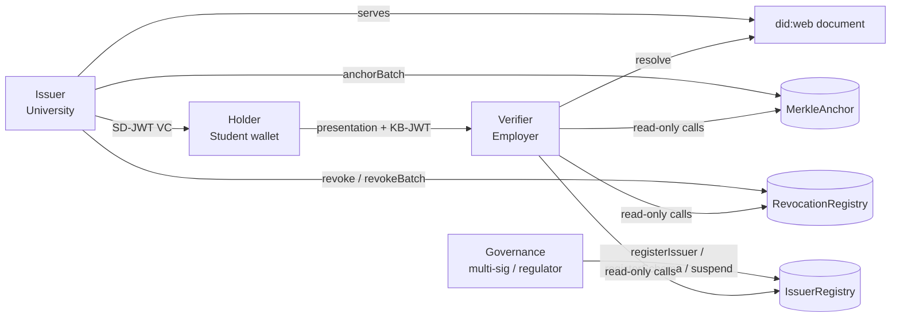

# Architecture

## Actors



| Actor | Trust assumption |
|---|---|
| Governance | Decides which institutions are accredited. Holds `GOVERNOR_ROLE`; production: multi-sig + timelock |
| Issuer | Trusted to attest to academic facts it controls. Its signing key (did:web) and its controller account (chain) are separate |
| Holder | Controls a private key that never leaves the wallet. Decides what to disclose to whom |
| Verifier | Untrusted with respect to data: learns only what the holder chooses to disclose |
| Chain | Public, append-only. Holds no personal data |

## Components

### Smart contracts (`contracts/`)

- **IssuerRegistry**: `didHash → {controller, status, did, metadataURI}` plus `schemaHash → Schema`.
  - Status machine: `None → Active ⇄ Suspended → Revoked` (terminal).
  - Roles: `DEFAULT_ADMIN_ROLE`, `GOVERNOR_ROLE`, `PAUSER_ROLE` (OpenZeppelin AccessControl).
  - Controller rotation is governor-only, so a stolen controller key cannot lock the issuer out.
- **RevocationRegistry**: per-issuer bitstring packed in `uint256` words (256 credentials per storage slot).
  - Only the issuer's controller can revoke, while the issuer is Active or Suspended.
  - Batches of up to 512. Idempotent.
  - Deliberately not pausable.
- **MerkleAnchor**: `didHash → root → {timestamp, block, leafCount}`.
  - Leaves use the OpenZeppelin `StandardMerkleTree` encoding of `keccak256(issuerSignedJwt)`.
  - `verifyInclusion` is available on-chain. The SDK also verifies off-chain.

Gas profile: registering an issuer is a one-off cost. One anchor transaction covers thousands of credentials, and one revocation transaction covers up to 512. Verification costs nothing (`eth_call`).

### Credential format

SD-JWT VC (`typ: dc+sd-jwt`), ES256, signed with a key listed in the issuer's did:web `assertionMethod`:

```json
{
  "iss": "did:web:university.edu",
  "iat": 1767225600, "nbf": 1767225600, "exp": 1924992000,
  "vct": "urn:blockcred:vct:degree:v1",
  "jti": "urn:uuid:…",
  "issuer_name": "Demo Institute of Technology",
  "cnf": { "jwk": { "kty": "EC", "crv": "P-256", "x": "…", "y": "…" } },
  "status": { "blockcred": { "chain_id": 80002, "registry": "0x…", "idx": 734512 } },
  "_sd": ["…digests of student_id, name, degree, major, cgpa, graduation_date + decoys…"],
  "_sd_alg": "sha-256"
}
```

- Every subject attribute is selectively disclosable. Decoy digests hide how many claims exist.
- `cnf.jwk` binds the credential to the holder's wallet key. Presentations must carry a KB-JWT `{aud, nonce, iat, sd_hash}` signed by that key.
- `status.blockcred.idx` is drawn at random from `STATUS_INDEX_SPACE`, so it leaks neither issuance order nor volume.

### Issuance flow (OpenID4VCI-inspired)

1. Admin uploads records (CSV / JSON / mocked DigiLocker). The service creates **offers** with a random code. Only `sha256(code)` is stored.
2. Wallet → `POST /offers/:code/redeem` with a proof JWT (`typ: openid4vci-proof+jwt`, header `jwk`, payload `aud = issuer DID`, `nonce = code`).
3. Inside one DB transaction (`SELECT … FOR UPDATE`) the issuer:
   - allocates a unique random status index;
   - signs the SD-JWT VC;
   - stores only the leaf hash;
   - marks the offer redeemed and purges its claims.
4. The anchor worker collects unanchored leaves and builds a Merkle tree. It sends **one** `anchorBatch` transaction and stores a proof per credential.

### Verification pipeline (`@blockcred/sdk` → `BlockCredVerifier`)

```
parse → resolve did:web (cached) → key ∈ assertionMethod? → verify ES256 signature
      → every disclosure digest ∈ _sd → exp / nbf / iat
      → KB-JWT: signed by cnf.jwk, sd_hash matches, aud = me, nonce = mine, fresh
      → status points to MY chain + MY registry
      → parallel: isAccredited(iss), isSchemaRegistered(vct), getWord(idx >> 8)
      → optional: Merkle proof against anchored root
      → verdict
```

The revocation lookup reads the whole 256-bit word, not the single bit. The RPC provider therefore cannot tell which of the 256 credentials is being checked.

### Presentation flow

1. The verifier creates a request: random nonce, `aud`, requested fields, purpose, 5-minute TTL.
2. The request travels as JSON or QR. The wallet shows a consent screen and the holder selects the fields to disclose.
3. The wallet POSTs to `response_uri`. The verifier consumes the request atomically:
   `UPDATE … SET status='processing' WHERE status='pending' AND expires_at > now()`
   A second submission always fails.
4. The result and a consent-log entry (field names only) are stored. Disclosed values are purged after `RESULT_RETENTION_SEC`.

## Scaling

| Concern | Approach |
|---|---|
| API throughput | Stateless Express services; scale horizontally behind a load balancer |
| Concurrent on-chain writes | Postgres advisory lock + `NonceManager.reset()`, so replicas never collide on nonces |
| Anchoring | `pg_try_advisory_lock`, so one leader per tick. Idempotent: an already-anchored root is reconciled, not re-sent |
| Gas | O(1) transactions per batch of `ANCHOR_MAX_BATCH` credentials; 512 revocations per transaction |
| Verifier latency | Three chain reads in parallel; did:web cache; RPC failover via `FallbackProvider` |
| Status index space | 2^20 default (4,096 storage words per issuer); configurable |
| Database | Indexed hot paths (`unanchored`, `subject_ref`, purge); only hashes stored per credential |

## Why these choices

- **EVM (Polygon Amoy / Sepolia) instead of Hyperledger Fabric:** free public testnets, mature tooling and public verifiability. No channel, CA or chaincode operations.
- **did:web:** institutions already own domains. Resolution is plain HTTPS, and key rotation is a file update. The trade-off is that the domain becomes a dependency. Mitigations:
  - verifiers cache DID documents;
  - accreditation is anchored on-chain, independently of the domain;
  - the DID-document hash could also be anchored (future work).
- **SD-JWT over BBS+:** standardised (IETF), simple and well supported, and selective disclosure covers the main privacy requirement. Predicate proofs are future work.
