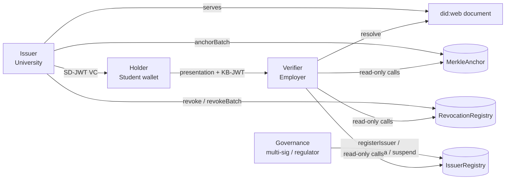

# Architecture

## Actors



| Actor | Trust assumption |
|---|---|
| Governance | Decides which institutions are accredited. Holds `GOVERNOR_ROLE`; production: multi-sig + timelock |
| Issuer | Trusted to attest to academic facts it controls. Its signing key (did:web) and its controller account (chain) are separate |
| Holder | Controls a wallet key generated in the browser; the platform only stores a password-encrypted copy it cannot open. Decides what to disclose to whom |
| Verifier | Untrusted with respect to data: learns only what the holder chooses to disclose |
| Chain | Public, append-only. Holds no personal data |

## Components

### Smart contracts (`contracts/`)

- **IssuerRegistry**: `didHash → {controller, status, did, metadataURI}` plus `schemaHash → Schema`.
  - Status machine: `None → Active ⇄ Suspended → Revoked` (terminal).
  - Roles: `DEFAULT_ADMIN_ROLE`, `GOVERNOR_ROLE`, `PAUSER_ROLE` (OpenZeppelin AccessControl).
  - Controller rotation is governor-only, so a stolen controller key cannot lock the issuer out.
- **RevocationRegistry**: per-issuer bitstring packed in `uint256` words (256 credentials per storage slot).
  - Only the issuer's controller can revoke, while the issuer is Active or Suspended.
  - Batches of up to 512. Idempotent.
  - Deliberately not pausable.
- **MerkleAnchor**: `didHash → root → {timestamp, block, leafCount}`.
  - Leaves use the OpenZeppelin `StandardMerkleTree` encoding of `keccak256(issuerSignedJwt)`.
  - `verifyInclusion` is available on-chain. The SDK also verifies off-chain.

Gas profile: registering an issuer is a one-off cost. One anchor transaction covers thousands of credentials, and one revocation transaction covers up to 512. Verification costs nothing (`eth_call`).

### Credential format

SD-JWT VC (`typ: dc+sd-jwt`), ES256, signed with a key listed in the issuer's did:web `assertionMethod`:

```json
{
  "iss": "did:web:university.edu",
  "iat": 1767225600, "nbf": 1767225600, "exp": 1924992000,
  "vct": "urn:blockcred:vct:degree:v1",
  "jti": "urn:uuid:…",
  "issuer_name": "Demo Institute of Technology",
  "cnf": { "jwk": { "kty": "EC", "crv": "P-256", "x": "…", "y": "…" } },
  "status": { "blockcred": { "chain_id": 80002, "registry": "0x…", "idx": 734512 } },
  "_sd": ["…digests of student_id, name, degree, major, cgpa, graduation_date + decoys…"],
  "_sd_alg": "sha-256"
}
```

- Every subject attribute is selectively disclosable. Decoy digests hide how many claims exist.
- `cnf.jwk` binds the credential to the holder's wallet key. Presentations must carry a KB-JWT `{aud, nonce, iat, sd_hash}` signed by that key.
- `status.blockcred.idx` is drawn at random from `STATUS_INDEX_SPACE`, so it leaks neither issuance order nor volume.

### Accounts and roles (v2)

There is one API service (`services/api`) and one PostgreSQL database. Each account has exactly one role:

| Role | Created by | Holds |
|---|---|---|
| `admin` | Seeded from `.env` at start-up | Acts through the platform governor key (`GOVERNOR_ROLE`) |
| `university` | Self sign-up → **pending** until the admin approves | Its own did:web identity, signing keys (`active` / `retired` / `revoked`) and an Ethereum controller account. Private material is AES-256-GCM sealed with `MASTER_ENCRYPTION_KEY` |
| `student` | Self sign-up | A P-256 wallet key generated **in the browser**. The server stores the public JWK plus the private key encrypted with a key derived from the password (PBKDF2-SHA256, 310k iterations, AES-GCM) |
| `employer` | Self sign-up | Its own verifier audience: `<PUBLIC_URL>/verifiers/<employerId>` |

Authentication:
- The browser sends `PBKDF2(password, "blockcred-auth-v1:" + email)` instead of the password. The server hashes that again with scrypt.
- The server therefore never learns the password and cannot derive the student's wallet-wrapping key.
- Sessions are random tokens in an HttpOnly, SameSite=Strict cookie; the database stores only their SHA-256.

### Issuance flow

1. **University signs up.** The API creates `did:web:<host>:issuers:<slug>` (served at `/issuers/<slug>/did.json`), signing key `key-1` and a fresh controller account. Status: `pending`.
2. **Admin approves.** The governor calls `IssuerRegistry.registerIssuer(did, controller)` and sends `ISSUER_FUNDING_ETH` to the controller for gas. Status: `active`.
3. **University adds records** (form, CSV or DigiLocker mock), keyed by student e-mail. Status: `awaiting_student`.
4. Whenever a student account exists for that e-mail (immediately, or at the student's sign-up), the API:
   - allocates a random status index (unique per issuer);
   - signs the SD-JWT VC with the university's active key, with `cnf.jwk` = the student's registered wallet key;
   - stores the leaf hash and puts the credential in the student's wallet.
5. **Anchor worker.** Every `ANCHOR_INTERVAL_SEC` (or on demand) it builds one Merkle tree per university, sends `anchorBatch` from that university's controller, and stores each credential's proof.

### Presentation flow

1. **Employer creates a request:** purpose, fields, random single-use nonce and the employer's own audience. It goes either to a student e-mail (inbox) or out as an open code/QR.
2. **Student reviews and consents** in the dashboard and picks the fields.
3. **The browser builds the presentation** from the selected disclosures plus a KB-JWT `{aud, nonce, iat, sd_hash}`, signed with the non-extractable wallet key.
4. **The API consumes the request atomically:**
   `UPDATE … SET status='processing' WHERE status='pending' AND expires_at > now()`
   Then it verifies with the **same public pipeline any external verifier uses**: did:web over HTTP, signature, disclosures, holder binding, nonce/audience, then on-chain accreditation, schema, revocation and anchor. Finally it checks that the holder key matches the responding student's registered key.
5. **Result and consent log.** The result goes to the employer. The consent log stores field names only, and disclosed values are purged after `RESULT_RETENTION_HOURS`.

## Scaling

| Concern | Approach |
|---|---|
| API throughput | Stateless Express services; scale horizontally behind a load balancer |
| Concurrent on-chain writes | Postgres advisory lock per sending account (governor / each university controller), so replicas never collide on nonces |
| Anchoring | Per-university `pg_try_advisory_lock`, so one leader per university per tick. Idempotent: an already-anchored root is reconciled, not re-sent |
| Gas | O(1) transactions per batch of `ANCHOR_MAX_BATCH` credentials; 512 revocations per transaction |
| Verifier latency | Three chain reads in parallel; did:web cache; RPC failover via `FallbackProvider` |
| Status index space | 2^20 default (4,096 storage words per issuer); configurable |
| Database | Indexed hot paths (`unanchored`, `subject_ref`, purge); only hashes stored per credential |

## Why these choices

- **EVM (Polygon Amoy / Sepolia) instead of Hyperledger Fabric:** free public testnets, mature tooling and public verifiability. No channel, CA or chaincode operations.
- **did:web:** institutions already own domains. Resolution is plain HTTPS, and key rotation is a file update. The trade-off is that the domain becomes a dependency. Mitigations:
  - verifiers cache DID documents;
  - accreditation is anchored on-chain, independently of the domain;
  - the DID-document hash could also be anchored (future work).
- **SD-JWT over BBS+:** standardised (IETF), simple and well supported, and selective disclosure covers the main privacy requirement. Predicate proofs are future work.
